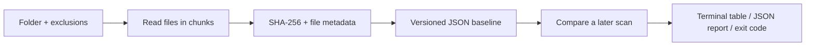

# File Integrity Ledger

**A small digital forensics lab in your terminal: capture a folder's fingerprints,
change the evidence, and explain exactly what changed.**

[](https://github.com/rlken/file-integrity-ledger/actions/workflows/tests.yml)

[](LICENSE)

`iledger` fingerprints file contents with SHA-256, saves a JSON baseline, and
reports **added, modified, and missing files** on the next check. It is a focused
Python portfolio project exploring evidence integrity, filesystem edge cases,
and reproducible command-line tooling.

```text
$ iledger check case-baseline.json

Check: CHANGED
1 unchanged · 1 added · 1 modified · 1 missing
┏━━━━━━━━━━┳━━━━━━━━━━━━━━━┓
┃ Status   ┃ Relative path ┃
┡━━━━━━━━━━╇━━━━━━━━━━━━━━━┩
│ ADDED    │ new-file.txt  │
│ MODIFIED │ notes.txt     │
│ MISSING  │ photo.txt     │
└──────────┴───────────────┘
```

*Example from the included demo; the machine-specific folder path is omitted.*

## Try it in two minutes

On macOS or Linux with Python 3.9 or newer:

```sh
git clone https://github.com/rlken/file-integrity-ledger.git
cd file-integrity-ledger
python3 -m venv .venv
source .venv/bin/activate
python -m pip install -e .
python scripts/demo.py
```

The demo creates fictional evidence under a new `demo-output/case-…/` folder. It
checks an unchanged baseline, makes three deliberate changes, and verifies the
result. It leaves the baseline, sample files, and JSON report available to inspect.
It never edits your own evidence files.

Read the [case study](docs/case-study.md) for the scenario, expected findings, and
what those findings can—and cannot—establish.

## What it does well

- **Content checks:** streaming SHA-256 hashing with a 1 MiB read buffer.
- **Reviewable evidence:** relative file paths, UTC scan timestamps, recorded sizes
  and modification times, and before/after hashes in JSON reports.
- **Explicit scope:** saved exclusion patterns reused during later checks.
- **Honest errors:** unreadable or changing files make a check incomplete; an
  incomplete baseline is never written.
- **Protected baselines:** atomic file replacement and explicit overwrite opt-in.
- **Scriptable results:** separate exit codes for unchanged, changed, and error.
- **Tested behavior:** regression tests, branch coverage, formatting/lint checks,
  and a CI matrix for macOS and Linux.

## Everyday commands

```sh
# Store a baseline separately from the sample evidence.
iledger baseline ./evidence -o ./case-baseline.json

# Compare the original folder against it.
iledger check ./case-baseline.json

# Export a report outside the evidence folder.
iledger check ./case-baseline.json --json > ./case-report.json

# Verify a copy at a different location.
iledger check ./case-baseline.json --root ./evidence-copy

# Review the baseline's scope without rescanning.
iledger inspect ./case-baseline.json

iledger --help
iledger --version
```

Without `-o`, a baseline is saved in `FOLDER/.iledger/baseline.json`. Existing
baselines are never replaced unless you pass `--force`. Prefer separate baseline
names when you want to preserve history. A check never updates the baseline.

| Check exit code | Meaning |
| --- | --- |
| `0` | All included file contents match the baseline. |
| `1` | Scan completed; added, modified, or missing files were found. |
| `2` | Invalid input or incomplete scan; review the errors. |

Exit code `1` is an expected result when changes exist, so shell scripts and CI
should handle it deliberately. A rename appears as one missing path and one added
path. Timestamp-only changes do not count as content changes. Empty directories
are not tracked.

### Choose your scan scope

```sh
iledger baseline ./evidence -o ./case-baseline.json --exclude '*.tmp' --exclude cache
```

The defaults exclude `.git`, `.venv`, `__pycache__`, and `.iledger` at any depth.
Other hidden files are included. Exclusions are recorded in the manifest, so a
later check uses the same scope.

- A bare pattern such as `*.tmp` matches any path component.
- A pattern containing `/` matches the root-relative POSIX path.
- A leading `/` anchors a pattern at the root: `/snapshot.json` does not exclude
  `nested/snapshot.json`.
- Matching is case-sensitive, using Python `fnmatch` semantics. These are not
  gitignore rules; `*` in a path pattern can span `/`.
- Quote shell wildcards. Symbolic links and special files must be explicitly
  excluded if you want to skip them; otherwise they produce scan errors.

Keep exported reports outside the scanned folder or inside its excluded
`.iledger` folder. Shell redirection creates the report before scanning starts;
a report in the evidence folder would otherwise become part of the scan.

## Design and boundaries



The implementation keeps file reading, manifest storage, and presentation
separate. The [design notes](docs/design.md) explain the decisions, schema,
error model, and testing strategy.

**Integrity is only as useful as the baseline you trust.** Manifests are not signed
or authenticated. Someone who can change both the files and their baseline could
conceal a modification. Store a trusted baseline separately when the comparison
matters.

This is an educational content comparison tool, not a forensic acquisition suite.
It does not recover deleted data, acquire disk images, verify permissions or
extended attributes, or establish chain of custody. It scans live files rather
than an atomic filesystem snapshot; per-file checks catch common concurrent
changes, but do not guarantee consistency against a hostile process changing the
directory tree. Reads may update access times. Use a stable copy or snapshot when
repeatability matters.

Windows is not currently a supported/tested platform. The initial support target
is macOS and Linux.

## Develop and test

```sh
python -m pip install -e '.[dev]'
ruff check .
ruff format --check .
python -m coverage run -m unittest discover -s tests -v
python -m coverage report
python -m build
```

CI enforces a 90% combined statement/branch coverage floor. Tests exercise known
hash vectors, large binary files, nested and unusual filenames, same-name baseline
exclusions, read failures, concurrent modifications, malformed manifests, and
failed writes. The package build is also installed and smoke-tested independently
of the source checkout.

See [CONTRIBUTING.md](CONTRIBUTING.md) for a short contribution guide.

## Next experiments

- Compare two saved baselines without rescanning the filesystem.
- Report metadata changes separately from content changes.
- Explore authenticated manifests with an explicit key-management design.

These are future ideas, not current features. The current project intentionally
keeps its scope small enough to understand and test.

Released under the [MIT license](LICENSE).
